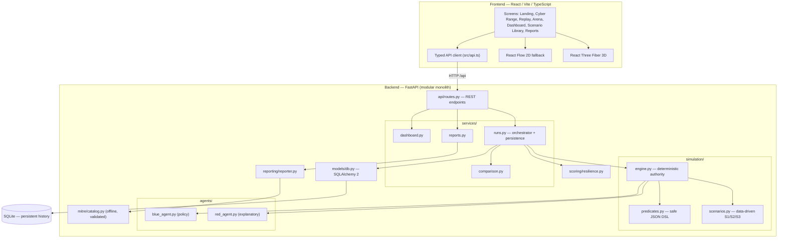
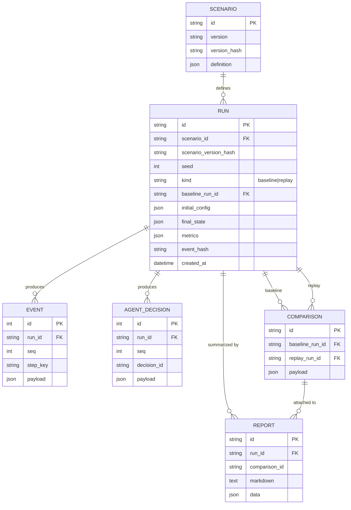
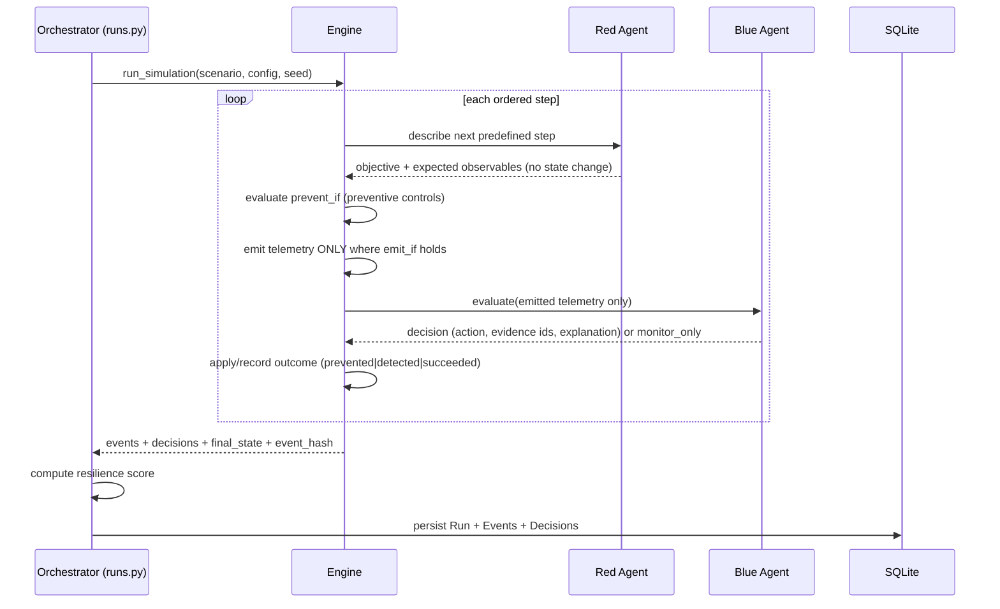
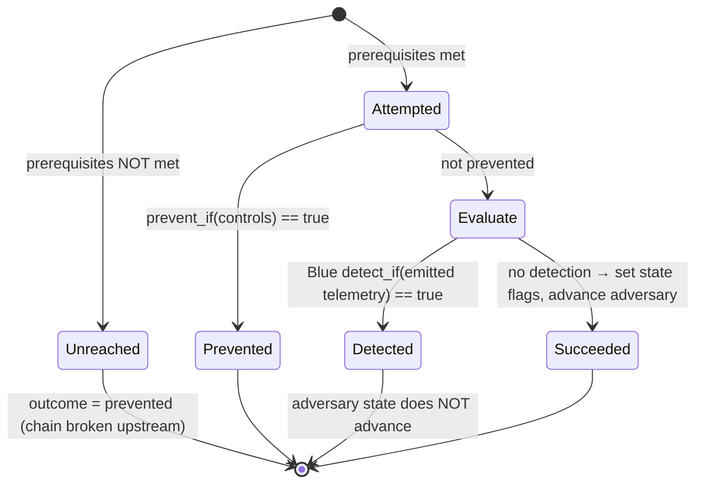
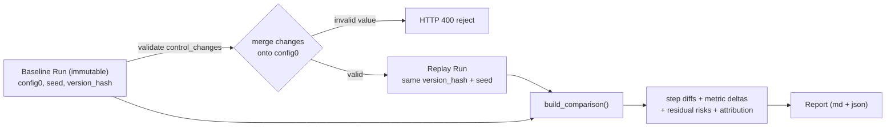
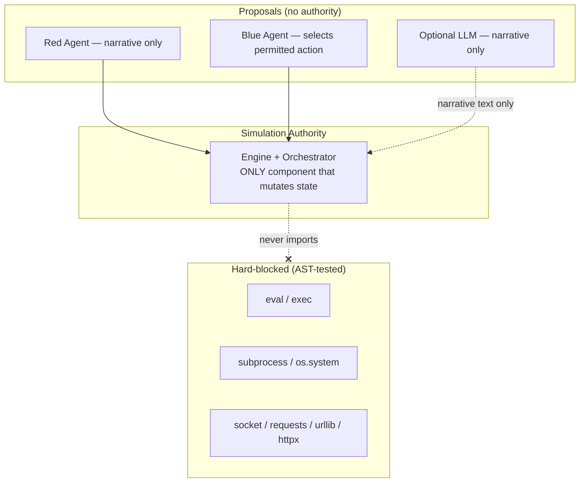

# SpecterRed X — Architecture

A modular-monolith backend with a strict trust boundary: **agents propose, the engine/orchestrator decides and persists.** All diagrams below describe the implementation that actually exists in this repository.

## System architecture

## Database relationships

## Agent interaction (per scenario step)

## Simulation state transitions

## Counterfactual replay

## Trust boundaries

The forbidden-primitive boundary is enforced by `tests/test_simulation.py::test_no_prohibited_primitives_in_simulation_and_agents`, which parses the `simulation/`, `agents/`, and `scoring/` modules with Python's AST and fails if any banned call or import appears.
